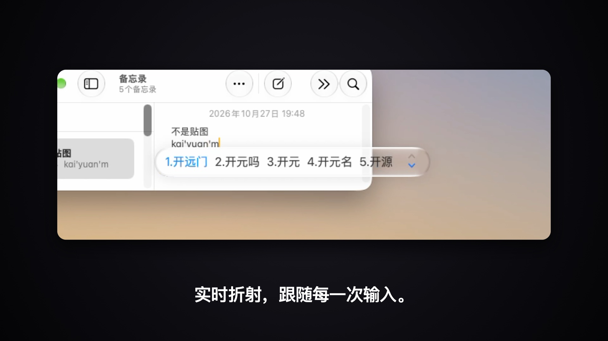
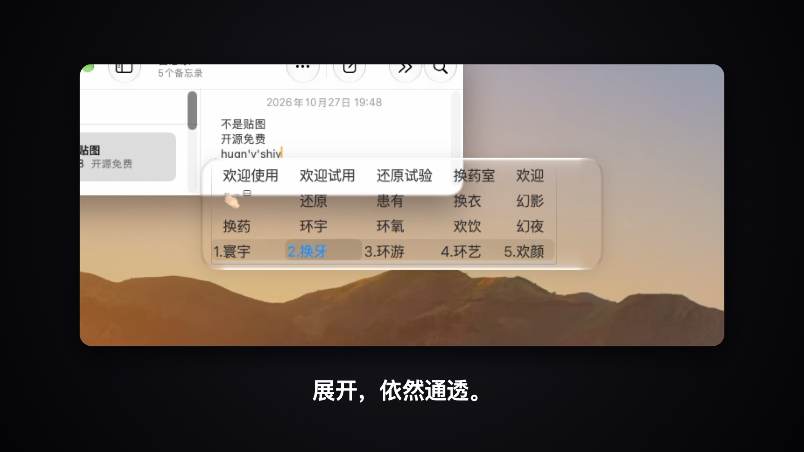

# SogouGlass · 搜狗输入法液态玻璃

给 **搜狗输入法 Mac 版** 的候选框换上 macOS 原生的「液态玻璃」：背后的内容实时折射、边缘带细亮线和柔和投影，和 Dock 是同一类玻璃效果。不是贴图，而是系统实时渲染的。





## 原理

搜狗的皮肤只能用静态贴图，做不出实时的玻璃。SogouGlass 换了个思路：

1. 给搜狗装一个 **底板全透明** 的皮肤，搜狗只负责显示文字；
2. SogouGlass 在后台找到搜狗的候选框窗口，在它 **正下方一层** 垫一块系统原生的 `NSGlassEffectView`，并以 120Hz 跟随候选框移动、变大。

全程不修改搜狗本身，读取候选框位置也不需要任何系统权限。

## 要求

- macOS 26 或更高版本（液态玻璃从 macOS 26 开始才有；作者在 macOS 27 上测试）
- 搜狗输入法 Mac 版
- Xcode 命令行工具（用来在本机编译，没有的话运行 `xcode-select --install`）

## 安装

```bash
git clone <本仓库地址> SogouGlass
cd SogouGlass
./install.sh
```

装好后菜单栏会出现一个水滴图标，打几个字就能看到效果。首次启动会自动安装「液态玻璃」皮肤并让搜狗切换过去。

## 使用

点菜单栏的水滴图标：

| 菜单 | 作用 |
|---|---|
| 液态玻璃 | 临时关掉 / 打开玻璃（关掉时自动切回搜狗默认皮肤） |
| 首选词颜色 | 蓝色，或石墨灰（见下面「已知问题」） |
| 重新应用皮肤 | 搜狗升级后皮肤被重置时用 |
| 开机自动启动 | 登录时自动运行 |
| 还原搜狗默认皮肤并退出 | 不想用了 |

退出 SogouGlass 时会自动切回搜狗默认皮肤（透明皮肤没有玻璃会只剩文字），下次启动再切回来。

## 调参

改完一秒内生效，不用重启：

```bash
defaults write com.zijue.sogouglass shadowOpacity -float 0.18   # 投影深浅，0 关闭
defaults write com.zijue.sogouglass insetX -float -8            # 玻璃比候选框左右各宽多少
defaults write com.zijue.sogouglass maxRadius -float 16         # 最大圆角
```

全部参数见 [`Sources/Glass.swift`](Sources/Glass.swift) 开头。

## 卸载

```bash
./uninstall.sh
```

会还原搜狗默认皮肤、移除液态玻璃皮肤、取消开机自启并删除 App。

## 已知问题

- **展开面板的细框**：在展开的多行候选面板里往下翻时，搜狗会在候选区外画一个细框，颜色固定等于首选词颜色。这是搜狗内置的，皮肤里关不掉；把首选词颜色换成「石墨灰」后细框会淡很多。
- **用到了系统内部接口**：Dock 那种透镜玻璃是 `NSGlassEffectView` 的内部变体（`_variant = 11`），公开的 `.clear` 样式偏毛玻璃。如果以后的系统版本去掉了这个接口，SogouGlass 会自动退回公开样式，不会崩溃。也因为这个原因，它不能上架 Mac App Store。
- **搜狗升级**：升级后皮肤设置可能被重置，点「重新应用皮肤」即可。

## 目录

| 路径 | 内容 |
|---|---|
| `Sources/` | App 源码：`Glass.swift` 玻璃跟随，`SkinInstaller.swift` 皮肤安装，`main.swift` 菜单栏入口 |
| `Skin/LiquidGlass/` | 透明皮肤（`skin.plist` + PNG，浅色 / 深色两套） |
| `Skin/make_skin.swift` | 重新生成皮肤贴图：`swift Skin/make_skin.swift Skin/LiquidGlass overlay` |
| `tools/` | 开发用：切换皮肤、候选框自动截图、玻璃样品墙 |
## 支持作者

如果你喜欢这个小工具，欢迎打赏支持 ☕️


## 声明

本项目与搜狗、腾讯、Apple 均无关联。「搜狗输入法」是其所有者的商标，这里仅用于说明适用对象。

## 许可

[MIT](LICENSE)
